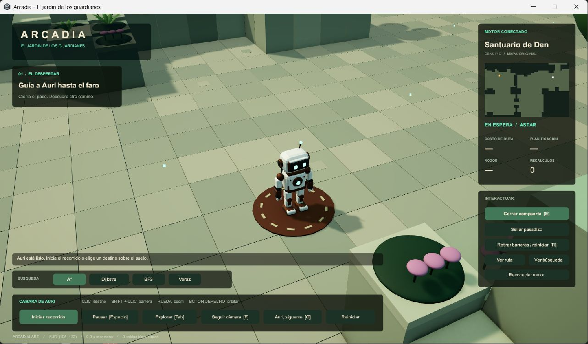
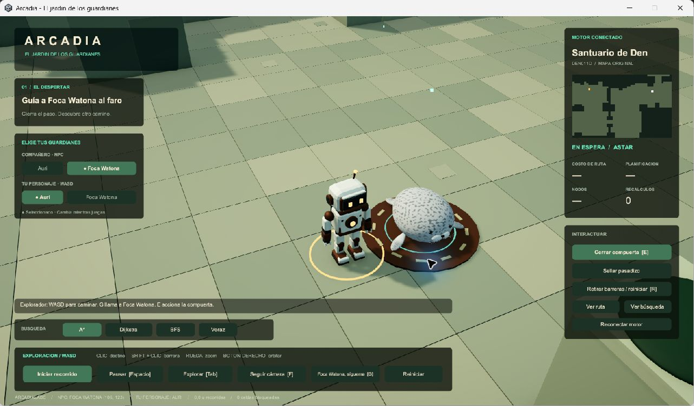

# Arcadia — El jardín de los guardianes

Demostración jugable de navegación sobre el mapa `den011d` de Moving AI. Auri es un autómata de cerámica, bronce y cristal que recorre un santuario vegetal siguiendo las rutas del motor Python. El proyecto está en `unity/Arcadia`, con Unity **6000.6.7f1** y Universal Render Pipeline.



## Abrir la demostración

Desde el explorador de Windows, ejecuta **`unity/Start-Arcadia.cmd`**. También puedes iniciar desde la raíz del repositorio:

```powershell
powershell.exe -NoProfile -ExecutionPolicy Bypass -File .\unity\Start-Arcadia.ps1
```

El lanzador comprueba `http://127.0.0.1:8000/health`, reutiliza el motor si ya está disponible y verifica que `/mapas` contenga `den011d`. Si hace falta, inicia `engine/.venv/Scripts/python.exe -m uvicorn npc_nav.api.main:app` como servicio local con ventana oculta. Cuando el motor responde, abre `unity/Arcadia/Builds/Arcadia/Arcadia.exe`.

Se utiliza el entorno Python existente, sin instalar paquetes. Si falta el entorno o el extra `api`, sigue la preparación de [engine/README.md](../engine/README.md). Los registros del proceso iniciado por el lanzador se guardan en `unity/Arcadia/Logs/engine-*.stdout.log` y `engine-*.stderr.log`; `launcher-engine.json` identifica su PID, hora y archivos. El motor queda activo al cerrar el juego para poder reutilizarlo en el Editor o en la web. El lanzador no termina otros servidores ni sustituye procesos que ocupen el puerto 8000.

Si aún no existe el ejecutable, el lanzador deja listo el motor y muestra cómo abrir el proyecto en el Editor.

## Trabajar desde Unity

1. En Unity Hub, agrega la carpeta **`unity/Arcadia`** y ábrela con Unity 6000.6.7f1.
2. Inicia solamente el motor:

   ```powershell
   powershell.exe -NoProfile -ExecutionPolicy Bypass -File .\unity\Start-Arcadia.ps1 -EngineOnly
   ```

3. Abre `Assets/Arcadia/Scenes/ArcadiaGarden.unity` y pulsa **Play**. Si necesitas regenerar la escena, usa **Arcadia → Crear o actualizar escena**.
4. Para generar la aplicación de Windows, usa **Arcadia → Compilar Windows**. La salida es `unity/Arcadia/Builds/Arcadia/Arcadia.exe`.

Las opciones para crear o compilar regeneran la escena a partir del constructor. Guarda tus cambios artísticos particulares en una copia si estás editando manualmente la escena generada.

## Controles

El panel **Elige tus guardianes**, a la izquierda, permite elegir **Auri** o **Foca Watona** de forma independiente para el **compañero NPC** y **tu personaje jugable**. Puedes combinar ambos modelos o usar dos focas. El aro turquesa identifica al NPC y el ámbar al jugador. Para ver y controlar al jugador, pulsa **Tab**.

La elección se guarda localmente para la siguiente sesión. Cambiar el modelo durante el recorrido conserva la posición, la ruta, los obstáculos, la pausa y el seguimiento. **R** reinicia el experimento y mantiene los personajes elegidos. La foca se desliza con movimiento de aletas y cola; Auri conserva su animación mecánica.



| Acción | Control |
|---|---|
| Llevar a Auri al faro | Botón **Iniciar recorrido** |
| Elegir otro destino | Clic izquierdo en terreno transitable |
| Colocar o retirar una barrera | **Shift + clic izquierdo** en una celda |
| Cerrar o abrir la compuerta | **E** o botón correspondiente |
| Sellar o liberar el segundo pasadizo | Botón **Sellar pasadizo** |
| Pausar o continuar el desplazamiento | **Espacio** |
| Reiniciar posición y retirar obstáculos | **R** |
| Alternar vista táctica y explorador controlable | **Tab** |
| Mover la cámara en vista táctica | **WASD** o flechas |
| Caminar con el explorador | **WASD** o flechas; **Shift izquierdo** para correr |
| Llamar a Auri / dejar de seguir | **G**, en modo exploración |
| Cámara cercana siguiendo a Auri / vista táctica | **F** |
| Girar e inclinar la cámara | Mantener botón derecho y mover el ratón |
| Acercar o alejar | Rueda del ratón |
| Mostrar ruta o nodos expandidos | Botones **Ver ruta** y **Ver búsqueda** |
| Cambiar algoritmo | Botones **A\***, **Dijkstra**, **BFS**, **Voraz** |
| Recuperar la conexión | Botón **Reconectar motor** |

En el Editor, haz clic dentro de la pestaña **Game** para que reciba las teclas. En exploración, el explorador ámbar se controla directamente; Auri continúa calculando sus rutas mediante Python. El seguimiento actualiza el destino cada 1,2 segundos cuando hay suficiente separación.

## Una demostración para la exposición

1. Comprueba el indicador **MOTOR CONECTADO** y pulsa **Iniciar recorrido**.
2. Observa la ruta turquesa y el movimiento de Auri hacia el faro dorado.
3. Cierra la compuerta con **E** durante el recorrido. Si Auri ocupa una celda protegida, espera a que abandone esa zona y vuelve a intentarlo.
4. El NPC vuelve al centro de su última celda completada y Python calcula una alternativa desde esa posición. Comprueba el contador de recálculos.
5. Activa **Ver búsqueda** para mostrar las celdas expandidas. Prueba los otros algoritmos o sella el pasadizo para observar el estado **SIN RUTA** cuando el destino queda aislado. Retira los obstáculos para continuar.
6. Pulsa **Tab**, camina con el explorador y pulsa **G** para que Auri lo acompañe.

El panel presenta costo, tiempo de cálculo del algoritmo, nodos expandidos y recálculos. El tiempo del motor excluye red, animación y dibujo; el costo suma los pesos de las aristas y no equivale a la cantidad de pasos. Las métricas mostradas corresponden a la última consulta completada.

## Integración y alcance

- Unity consume la API HTTP existente: `GET /mapas/den011d` y `POST /buscar`. Todas las búsquedas se ejecutan en Python.
- El terreno de respaldo en `StreamingAssets/Arcadia/den011d.json` permite ver el escenario sin conexión. Antes de aceptar órdenes de navegación, se comprueba que el mapa recibido del motor coincide con ese terreno.
- Las posiciones de la API son `[fila, columna]`; en Unity se representan como `(x = columna, z = fila)`.
- Los obstáculos se envían completos en cada petición. La API actual no conserva el estado entre consultas; la replanificación utiliza A*, Dijkstra, BFS o voraz según la selección.
- Los movimientos diagonales respetan las dos celdas laterales libres. No se permite bloquear el destino, la celda ocupada ni el segmento que Auri está recorriendo.
- El escenario conserva la transitabilidad del dataset. La decoración no añade rutas, escaleras ni cambios de altura al grafo. El encuadre inicial y el minimapa destacan la zona del santuario.
- **D* Lite permanece pendiente**: este incremento prueba la integración y la replanificación con el motor actual. La coordinación y las colisiones entre múltiples agentes no forman parte de esta demostración.

## Validación

En el Editor, **Arcadia → Validate → Navigation safety** ejecuta comprobaciones de contrato JSON, reglas de movimiento, protección de obstáculos, pausa, cancelación y reinicio. También se puede invocar el método estático `Arcadia.Navigation.Editor.NavigationChecks.Run` en modo batch. Estas comprobaciones no sustituyen la prueba de conexión y del recorrido en Play.

Validación realizada el 22 de octubre de 2026: **56 aserciones del cliente** y **13 pruebas en Play Mode**, todas aprobadas. El informe de ejecución real está en [`docs/play-checks.json`](docs/play-checks.json). Incluye los cuatro algoritmos, movimiento, pausa, cambio de obstáculos a mitad de una arista, ausencia de ruta, recuperación y cancelación al desactivar/reactivar al NPC. El costo inicial de A* es 51,355339; al cerrar la compuerta desde el origen, 57,941125. El recálculo desde `(96,111)` coincide con Dijkstra: 41,798990.

Para repetir las pruebas con Unity CLI y Pipeline, inicia el motor y entra en Play Mode:

```powershell
unity command 'script run' --file ../tools/PlayChecks.cs --entry PlayChecks.Run --timeout 55 --json
```

El comando restaura la demostración al terminar. Ejecútalo sin interactuar con el juego durante esos segundos. Las comprobaciones directas y HTTP del dataset se encuentran en `tools/smoke_demo.py` y `docs/demo-smoke-*.json`.

También aprobaron las cinco comprobaciones de `tools/InteractionChecks.cs`: protección del explorador ante barreras, detención del seguimiento cuando falla el motor, reconexión y liberación del foco de los botones para que Espacio solo pause. Se ejecutan mediante el mismo comando, sustituyendo el archivo y el método por `InteractionChecks.Run`.

El 23 de octubre de 2026 se verificó además el ejecutable de Windows mediante Computer Use: apertura con el lanzador, conexión al motor, inicio del recorrido, cambio de cámara con F, exploración con Tab, respuesta a W, activación del seguimiento con G, cierre de compuerta con E y recálculo, pausa con Espacio y restauración con R. La [captura de la vista táctica](docs/arcadia-tactical.png) muestra la compuerta cerrada y un recálculo completado. El registro de esa sesión no contiene excepciones; URP informa advertencias sobre shaders de profundidad de campo y proyección Panini descartados, efectos que esta escena no utiliza.

El 25 de octubre de 2026 aprobaron las ocho pruebas adicionales de `tools/CharacterChecks.cs`, con informe en [`docs/character-checks.json`](docs/character-checks.json). Comprueban selección independiente, cambio durante movimiento y pausa sin recálculo, conservación del seguimiento, dos focas con materiales y roles distintos, foco de los botones, preferencias, reinicio y reemplazos repetidos sin modelos duplicados. También se repitieron las 13 pruebas de navegación y las 56 aserciones del cliente. Para repetir las ocho pruebas, usa el comando anterior con `--file ../tools/CharacterChecks.cs --entry CharacterChecks.Run`.

En el ejecutable actualizado se comprobaron mediante Computer Use ambos selectores, dos focas simultáneas, movimiento del jugador con W, recorrido de la foca NPC mediante A*, cambio del jugador durante ese recorrido y conservación de las elecciones tras cerrar y reabrir la aplicación.

Las fuentes del arte están en [`art-source/`](art-source/). Los datos y la licencia del dataset original se documentan en [engine/data/README.md](../engine/data/README.md). `Library/`, `Temp/`, `Logs/` y los archivos de proyecto generados por Unity no se versionan.
